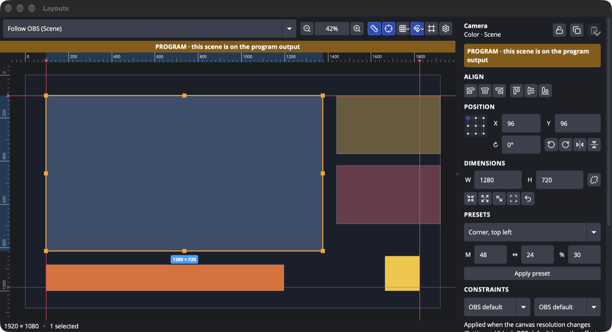
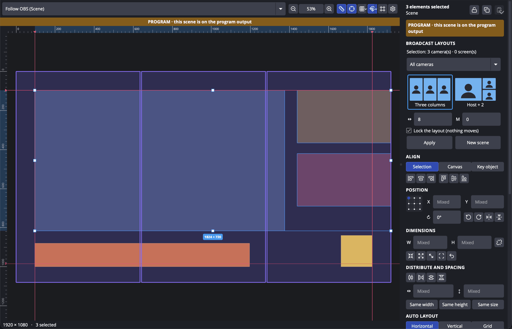

<div align="center">

# Layouts for OBS

[](https://github.com/TheOnAirCompany/obs-layouts/actions/workflows/push.yaml) [](https://github.com/TheOnAirCompany/obs-layouts/actions/workflows/core-tests.yaml) [](https://github.com/TheOnAirCompany/obs-layouts/releases) [](https://obsproject.com) [](#install) [](data/locale) [](LICENSE)

**Design your scenes. Pixel perfectly.**

Layouts for OBS is a native OBS Studio plugin that brings the composition tools of a design app to your scenes: a permanent **Inspector**, **rulers**, **guides**, **layout grids**, **smart snapping**, **alignment**, **distribution** and **measurements** — without touching your video output.

</div>



> **Status: 0.6.0.** Tested in OBS Studio 33.0.1 on macOS (Apple Silicon). Windows and Linux packages are built by CI but not tested at runtime yet. The macOS package is signed and notarized; Windows and Linux packages are not signed. Keep a backup of your scene collection and report anything odd in [Issues](https://github.com/TheOnAirCompany/obs-layouts/issues).

## What it adds

Two windows, both in the **Tools** menu and both open at once if you like (0.7):

- **Scene Editor**: a Scenes navigator above Layers on the left, the Canvas in the middle, the Inspector on the right.
- **Scene Builder**: the sources of the collection, the layouts that fit your selection, and Create.

### Scenes navigator

Above Layers: your scenes by canvas (Main 16:9, Vertical 9:16...), organized in the stacks of [Stacks for OBS](https://github.com/TheOnAirCompany/obs-stacks) when it is installed. Search, filter by 16:9, 9:16 or favorites. A click edits a scene without changing what is on air; a red dot marks the program, a green dot the preview. The **Follow OBS** pin in the Canvas toolbar edits whatever OBS shows.

### Layers

The left column of the Scene Editor, below the Scenes navigator: every source of the edited scene, front on top, groups unfolded. Click to select (Shift / Cmd for several), the eye hides, the lock locks, double-click renames, drag reorders or moves a source into or out of a group without moving it on screen. Everything is undoable. No need to go back to the OBS Sources dock.

### Types and Scene Builder

Give each source a type (Host, Cam, Screen, Chat, BG, CG) from a colored pill, or let Layouts suggest it from the name (`CAM _ GUEST 1`, `SCREEN _ RIGHT`, `TCHAT _ TWITCH`, `BG _ DYNAMIQUE`, `LOGO`). Filter Layers by type. **Tools > Scene Builder** lists every source of the collection: select the ones you want, pick a broadcast layout for 16:9, 9:16 or both (with [Vertical for OBS](https://github.com/TheOnAirCompany/obs-vertical), the 9:16 twin is linked to the 16:9 scene), check the large preview, name the scene, file it into a stack of Stacks, and create it (background at the back, hosts in the large tile, graphics on top where they already are), or create all the scenes of the show at once. **Open in Scene Editor ↗** takes you to the new scene.

### Inspector

The right column of the Scene Editor. It always shows the selection of the edited scene.

- **Position, size, rotation** in canvas pixels, from a **reference point** you pick on a 3×3 grid. W and H are the size you see, after scale, crop and bounding box.
- **Math in every field**: `1920/2`, `100% - 120`, `+20`, `-10`, `*1.5`, `=-10` for an absolute negative value. Drag a field label to scrub (Shift ×10, Alt ×0.1).
- **Ratio lock**, **Fit / Fill / Stretch** to the canvas, **original size**, **reset**, **rotate ±90°**, **flip**.
- **Crop** in source pixels (the image stays in place), **bounding box** type and alignment.
- **Style**: corners (Auto, px, Round, None), border, drop shadow (Soft, Hard or your own) and a fade during transitions, drawn by Layouts' own filters with a clean anti-aliased mask that follows the crop, without any shader plugin. Each type of source has a default style (**Styles by type…**); an item can have its own, and **Reset to type** brings it back.
- **Frame modes**: turn a 16:9 camera into a 1:1 or 9:16 tile by typing W and H or with a ratio button; Fill crops instead of distorting, anchored on the reference point.
- **Multiple selection**: align to the selection, the canvas or a **key object**; distribute centers or spacing; type an **exact gap**; same width / height / size; **Mixed** values.
- **Copy / paste properties** (position, size, rotation, crop, bounding box).
- **Broadcast layouts**: select your cameras, screens and chat, pick one of **118 TV-style layouts** (duo, three columns, host + guests, grids, screen + guests on the side or below, picture in picture, and inventive ones: tilted cards, Polaroid, bento, dock of bubbles, diagonal duo, card stack, masonry wall, porthole...) and apply it, or make a new scene with it. Cameras fill their tile, screens and chats are never cropped; slots can be tilted, round, cut on a diagonal or framed. Mirror the gallery left / right or top / bottom. Works on vertical canvases too (guests stack, screens on top). **Create show scenes** makes, in one click, a full-screen scene per guest and screen plus a scene for every layout that fits. **Lock the layout** keeps everything in place. **Save as layout** turns your own scene into a layout of the gallery, to export and import between machines.

  

- **Auto layout**: rows, columns or a grid, with gap, padding and alignment, inside the selection or the whole canvas, previewed on the Canvas before you apply it.
- **Presets**: corners, centered, full screen, lower third area, picture in picture, split screen, one large + two small, 2 × 2 grid, with margins you set.
- **Constraints** (Advanced): pin elements to an edge, the center, both edges or scale them, so they keep their place when the canvas resolution changes.

### Layouts Canvas

The editing surface in the middle of the Scene Editor, next to the OBS preview.

- **Rulers** in canvas pixels that follow zoom and pan, with the selection highlighted.
- **Guides**: drag them out of the rulers, move, lock, type an exact position, delete by dragging back. Per scene, or **global** for every scene. Saved with the scene collection.
- **Layout grids**: square grid (presets 8 to 64 px), columns, rows.
- **Smart snapping**: guides, grid, other elements (edges, centers, **equal spacing**), canvas — with red smart guides. Hold Ctrl/Cmd to bypass it, as in OBS.
- **Measurements**: hold Alt to see the distances to the hovered element or to the canvas.
- **Direct manipulation**: select, Shift-select, rubber band, move, resize from 8 handles, rotate just outside a corner, nudge with the arrows. The ratio lock decides whether the handles keep the ratio, Shift inverts it, Alt resizes from the center; a free resize crops (Fill) or letterboxes (Fit) instead of distorting. With several elements selected, the handles scale the whole selection.
- **Swap**: drop a camera on another camera (a screen on a screen, a chat on a chat) and they exchange their places, style and stacking, even in a locked layout. Alt + drag for a plain move.
- **Crop mode** (C): the handles crop the source and the image stays in place.
- **Zoom** (fit, 100 %, selection, pinch, Ctrl/Cmd + wheel) and **pan** (Space + drag, wheel).
- **Safe areas**, center lines and custom margins.
- Edit the scene OBS shows, or **pin any scene**, including scenes of other OBS 33 canvases (vertical...).

### Layouts Switcher

> Not included in 0.7: the Switcher is set aside for now. Developers can build it with `-DLAYOUTS_REGIE=ON`.

**Docks > Layouts Switcher** turns a scene of your show (the *Plateau*) into a vision mixer: a row of layouts, one bus of sources per slot, a PREVIEW line and **CUT**. Red is on air, green is in preview; with Studio Mode, prepare the next shot in preview and take it. Every action has an OBS hotkey (cut, next / previous layout, layouts 1 to 9, slot N = source M) and an obs-websocket request (vendor `layouts`), for Stream Deck and Companion.

If a camera or a screen on air stops sending video, the program drops at once to the same layout with one tile less and the Switcher shows a red banner; the original layout comes back by itself when the source returns.

**AUTO** (0.6) glides the program to the prepared layout inside the same scene: tiles move and resize, crops and rotations follow, tiles that leave fade out. The duration sits next to the button (300 ms by default). With Vertical for OBS installed, tick **Also switch the vertical 9:16 output**: the Plateau gets a 9:16 twin built from the same sources, and every CUT or AUTO switches both outputs.

### Made for live shows

- A red **● PROGRAM** chip and a red frame only when an audience really sees the scene you edit: it is on the program of its canvas and that canvas is streamed or sent to a virtual camera (recording alone does not count). Optionally **block edits on air**.
- Every change is applied **atomically** (never half an alignment on air) and is **one entry in OBS's Edit > Undo**, a whole drag included.
- Rulers, guides, grids and handles are drawn on Layouts' own display: they **never reach the video output** (verified pixel by pixel).
- Public OBS APIs only. The native preview, your sources and your scene collection files are never modified behind your back.

## Install

Download the file for your system from the [releases](https://github.com/TheOnAirCompany/obs-layouts/releases). OBS Studio **33.0.1 or later** is required.

| System | File | How to install |
|---|---|---|
| macOS 13+ (Apple Silicon and Intel) | `obs-layouts-<version>-macos-universal.pkg` | Open the package and follow the installer (it installs for the current user). The package is signed and notarized by Apple. |
| Windows 10/11 x64 | `obs-layouts-<version>-windows-x64.zip` | Extract the `obs-layouts` folder into `C:\ProgramData\obs-studio\plugins\`. |
| Ubuntu x86_64 | `obs-layouts-<version>-x86_64-linux-gnu.deb` | `sudo apt install ./obs-layouts-<version>-x86_64-linux-gnu.deb`. Needs the `obs-studio` package **33 or later** installed system-wide. |

Restart OBS, then open **Tools > Layouts**. Layouts is a regular window (resize it, maximize it, put it in full screen) with the Canvas in the middle and the Inspector on the right. It never adds anything to the OBS window. You can also give it a key in **Settings > Hotkeys** ("Layouts: Open the Layouts window").

To uninstall, remove the plugin. Your scenes and sources are never touched; Layouts only stores its guides in its own section of the scene collection.

## Shortcuts (Canvas focused)

| Keys | Action |
|---|---|
| Arrows, Shift + arrows | move 1 px, 10 px |
| Shift + drag | constrain to an axis; on a handle: invert the ratio lock |
| Ctrl/Cmd + drag | no snapping |
| Alt | measure; Alt + resize: from the center; Alt + drag: move without swapping |
| Space + drag | pan |
| Shift + 0 / 1 / 2 | zoom 100 % / fit / selection |
| + / − | zoom in / out |
| Shift + R, Shift + G, Ctrl/Cmd + ; | rulers, grid, guides |
| C | crop mode for the selected element |
| Esc | cancel a drag, leave crop mode, clear the selection |

Rulers, guides, grid, safe areas, snapping, the six alignments, distribution and zoom to fit can also get global keys in OBS **Settings > Hotkeys** (entries starting with "Layouts:").

## Documentation

| Document | Content |
|---|---|
| [Feasibility](docs/FEASIBILITY.md) | What OBS 33 allows, prototypes, measured performance |
| [Product requirements](docs/PRD.md) | Vision, personas, user stories, scope |
| [UX specification](docs/UX-SPECIFICATION.md) | Every interaction, state and shortcut |
| [Design system](docs/DESIGN-SYSTEM.md) | Tokens and components |
| [Coordinate system](docs/COORDINATE-SYSTEM.md) | The math behind every number |
| [Architecture](docs/ARCHITECTURE.md) | Components, data flow, persistence |
| [OBS integration](docs/OBS-INTEGRATION.md) | APIs used, threads, undo, live safety |
| [Implementation plan](docs/IMPLEMENTATION-PLAN.md) | Done and next |
| [Test plan](docs/TEST-PLAN.md) | Unit, in-OBS and manual tests, results |
| [Release plan](docs/RELEASE-PLAN.md) | Packaging, compatibility, checklist |

## Building

The build system comes from [obs-plugintemplate](https://github.com/obsproject/obs-plugintemplate), updated for OBS Studio 33.0.1.

```sh
cmake --preset macos          # or windows-x64, ubuntu-x86_64
cmake --build --preset macos
```

Core unit tests (no OBS needed):

```sh
cmake -S tests -B build_tests && cmake --build build_tests && ctest --test-dir build_tests
```

In-OBS self-test (development only): configure with `-DLAYOUTS_SELFTEST=ON` and start a **disposable** OBS configuration with `LAYOUTS_SELFTEST=1`. See the [test plan](docs/TEST-PLAN.md).

## License

[GPL-2.0-or-later](LICENSE), like OBS Studio.

Icons: [Lucide](https://lucide.dev) (ISC).

© 2026 The OnAir Company
